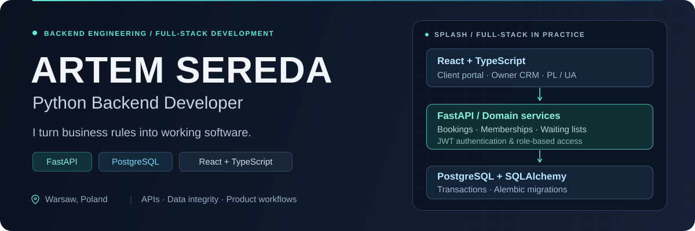

  

  
  
  

<strong>Open to Python backend roles and internships</strong>

## About me

I build Python backends and tools that connect APIs, process data, and automate repetitive tasks. My projects range from a Flask weather API with authentication and MySQL storage to asynchronous cryptocurrency price collection and web scraping.

Based in **Warsaw, Poland**, I'm studying **Computer Networks at Społeczna Akademia Nauk**. I enjoy working through backend problems: designing endpoints, handling API errors, and turning external data into useful results.

## Technical toolkit

| Area | Technologies |
| :--- | :--- |
| **Backend** | `Python` · `Flask` · `FastAPI` · `REST APIs` · `JWT authentication` |
| **Async & integrations** | `asyncio` · `aiohttp` · `httpx` · `Requests` |
| **Data** | `SQL` · `MySQL` · `JSON` · `CSV` |
| **Scraping & automation** | `BeautifulSoup` · `Playwright` |
| **Development** | `Git` · `GitHub` · `Postman` · `OOP` |

## Selected projects

<table>
  <tr>
    <td width="50%" valign="top">
      <h3>01 / Weather API</h3>
      
A Flask backend combining user accounts, protected weather endpoints, and persistent data storage.

      <ul>
        <li>JWT authentication and password hashing</li>
        <li>OpenWeather API integration</li>
        <li>Request quotas, user balances, and request history</li>
      </ul>
      
<code>Python</code> <code>Flask</code> <code>MySQL</code> <code>JWT</code>

      
<a href="https://github.com/seredartem/Weather_sell"><strong>Explore the backend →</strong></a>

    </td>
    <td width="50%" valign="top">
      <h3>02 / Async Crypto Monitor</h3>
      
An asynchronous client that collects cryptocurrency prices from the CoinGecko API and produces structured reports.

      <ul>
        <li>Concurrent HTTP requests with aiohttp and asyncio</li>
        <li>Retries for API rate-limit responses</li>
        <li>JSON output with prices, statuses, and timestamps</li>
      </ul>
      
<code>Python</code> <code>asyncio</code> <code>aiohttp</code> <code>JSON</code>

      
<a href="https://github.com/seredartem/Asynchronous-cryptocurrency-parsing"><strong>Explore the async client →</strong></a>

    </td>
  </tr>
  <tr>
    <td width="50%" valign="top">
      <h3>03 / Vinted Data Scraper</h3>
      
A web scraping project for extracting product information from marketplace listings.

      <ul>
        <li>HTML parsing with CSS selectors and pagination</li>
        <li>Product titles, prices, sizes, and listing links</li>
        <li>Listing image downloads</li>
      </ul>
      
<code>Python</code> <code>Requests</code> <code>BeautifulSoup</code>

      
<a href="https://github.com/seredartem/Web-scrapping-Vinted"><strong>Explore the scraper →</strong></a>

    </td>
    <td width="50%" valign="top">
      <h3>04 / Pixabay Image Downloader</h3>
      
A small command-line learning project for searching Pixabay and downloading an image through its API.

      <ul>
        <li>Search queries and image retrieval</li>
        <li>JSON-based settings</li>
        <li>Object-oriented Python structure</li>
      </ul>
      
<code>Python</code> <code>Requests</code> <code>REST API</code> <code>JSON</code>

      
<a href="https://github.com/seredartem/api_pixabay"><strong>Explore the downloader →</strong></a>

    </td>
  </tr>
</table>

## Education & languages

**Społeczna Akademia Nauk** · Computer Networks · 2024–2028, expected graduation

Additional Python training: **Genius Space** online courses and private Python lessons.

| English | Polish | Ukrainian | Russian |
| :--- | :--- | :--- | :--- |
| Intermediate | Intermediate | Native | Native |

---

  Have a backend opportunity or a project to discuss? 
  <a href="mailto:seredartem44@gmail.com"><strong>seredartem44@gmail.com</strong></a> · <a href="https://www.linkedin.com/in/artem-sereda-911580318/">LinkedIn</a>

